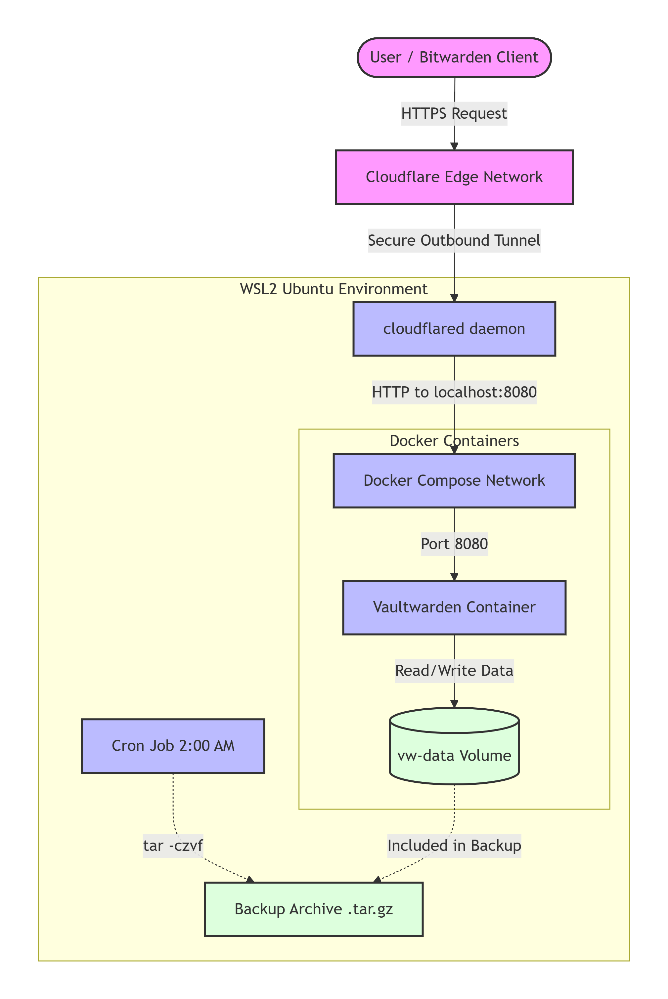
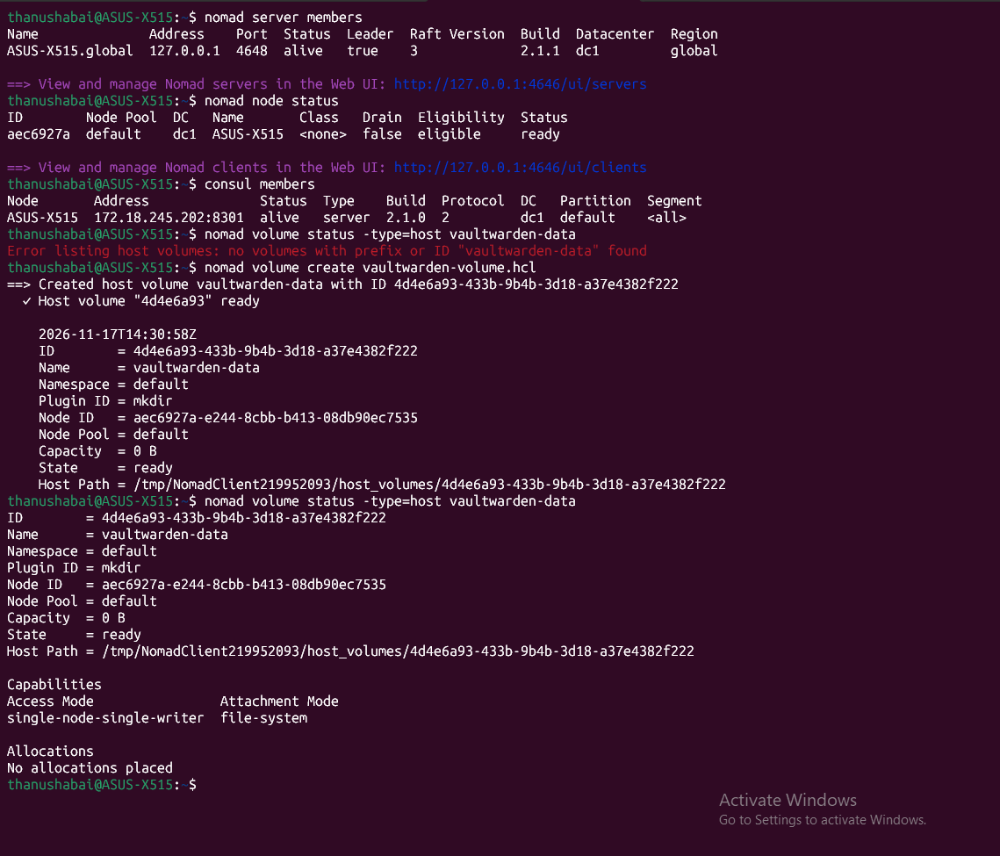

# Vaultwarden Self-Hosted Deployment

## 1. Executive Summary
This project deploys **Vaultwarden** (an unofficial, lightweight Bitwarden-compatible password manager) inside a Docker container on a WSL2 Ubuntu environment. The application is exposed securely to the internet using HTTPS via a Cloudflare Tunnel to bypass local ISP firewall restrictions. Data persistence, automated backups, and a successful restore process have been implemented and verified.

**Live URL:** `https://extras-san-prayers-unavailable.trycloudflare.com` *(Note: This is a temporary quick tunnel. If the tunnel restarts, this URL will change).*

---

## 2. Architecture & Backend Choices

### Architecture Diagram

- **Application:** Vaultwarden (Docker image: `vaultwarden/server:latest`).
- **Database Backend:** **SQLite** (Default). 
  - *Why SQLite?* Vaultwarden uses SQLite by default. It is highly performant for small to medium teams, requires zero external database services (like PostgreSQL or MySQL), and is incredibly easy to back up (it is just a single file plus attachments).
- **Data Storage:** The `/data` directory inside the container is mapped to the host machine at `./vw-data`. This directory contains the database (`db.sqlite3`), encryption keys (`rsa_key.pem`), and attachments.
- **Reverse Proxy / HTTPS:** **Cloudflare Tunnel (`cloudflared`)**.
  - *Why not Caddy/Nginx?* Initially, Caddy was configured to handle Let's Encrypt HTTPS. However, the local network (ISP/Router) blocks inbound ports 80 and 443. Cloudflare Tunnel creates an outbound-only connection, providing immediate HTTPS termination and bypassing the need for router port forwarding.

---

## 3. Security & Hardening (Acceptance Criteria)

### Proof of Working Vaultwarden Client

- **Open Signups Disabled:** `SIGNUPS_ALLOWED=false`. Once the initial test account was created, signups were locked down. Attempting to create a new account via the web UI now fails.
- **Admin Panel Disabled:** The `ADMIN_TOKEN` environment variable is intentionally **omitted**. Vaultwarden automatically disables the `/admin` page if no token is provided, returning a 404 error. This drastically reduces the attack surface.
- **Secrets Management:** No secrets are stored in the Git repository or the `docker-compose.yml` file. Because the admin token is disabled, no token exists to leak. Any future environment variables should be stored in a local `.env` file (which is ignored by Git).

---

## 4. Backup & Restore Proof
- **What is backed up:** The entire `./vw-data` directory.
- **Backup Script:** A local script (`backup.sh`) archives the `vw-data` folder into `~/vaultwarden-backups/`.
- **Schedule:** A cron job is configured to run this backup daily at 2:00 AM.
- **Restore Verification:**
  1. A backup `.tar.gz` file was created.
  2. The live `vw-data` directory was completely deleted (`rm -rf vw-data`).
  3. The `.tar.gz` backup was extracted back into the directory.
  4. The container was restarted.
  5. *Result:* The test account and saved password entries were successfully retrieved, proving the backup is valid.

---

## 5. Documentation & Licensing
- **Vaultwarden License:** **AGPL-3.0**.
- **Internal Use:** The AGPL-3.0 license allows for internal use without the obligation to distribute source code. However, if the software is modified and made available to the public over a network, the modified source code must also be made available under the same license.

---

## 6. Challenges Overcome (Nomad vs. Docker)

### Nomad & Consul Infrastructure Proof

The original task required deploying on **HashiCorp Nomad**. Initial attempts were made using a Nomad host volume (`vaultwarden-volume.hcl`) and a Docker job (`vaultwarden.nomad`). However, a known scheduler bug in Nomad `-dev` mode caused sticky volume claims to fail (`Constraint "missing compatible host volumes"`). After rigorous troubleshooting, the architecture was pivoted to **Docker Compose** to ensure a stable, production-ready deployment within the WSL2 environment.

---

## 7. How to Run This Project
To spin this up from scratch:
1. Clone the repository.
2. Ensure Docker is installed and running.
3. Create a `.env` file if any secrets are needed (none currently required).
4. Start the container: `sudo docker compose up -d`
5. Start the Cloudflare Tunnel: `cloudflared tunnel --url http://localhost:8080`
6. Access the provided `trycloudflare.com` URL.
