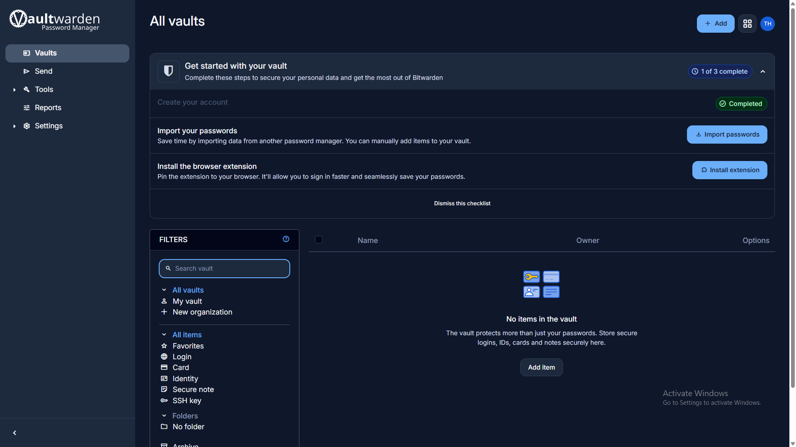
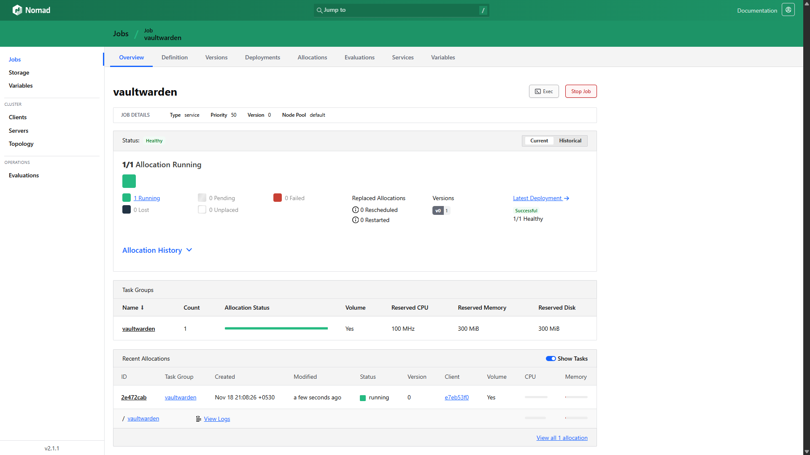
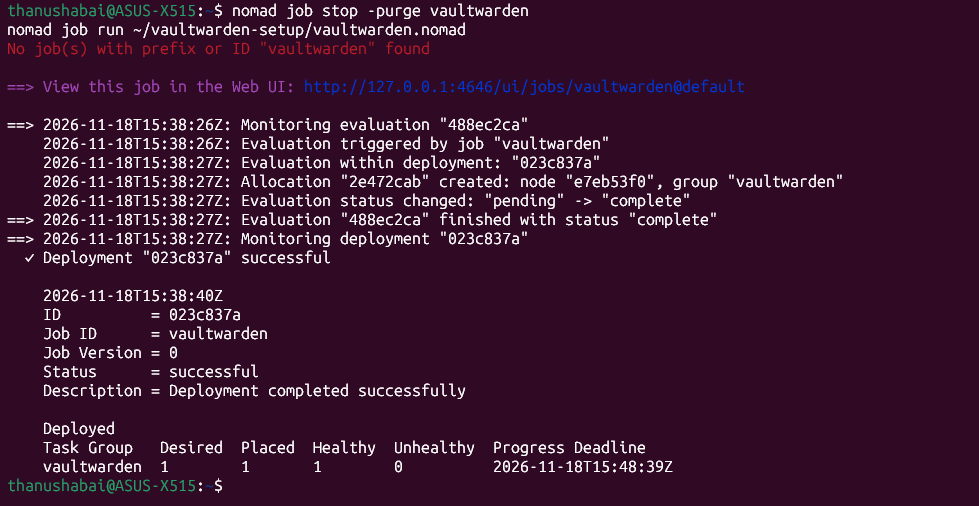

# Vaultwarden Self-Hosted Deployment

## 1. Executive Summary
This project deploys **Vaultwarden** (an unofficial, lightweight Bitwarden-compatible password manager) on a WSL2 Ubuntu environment. The application is exposed securely to the internet using HTTPS via a Cloudflare Tunnel to bypass local ISP firewall restrictions. Data persistence, automated backups, and a successful restore process have been implemented and verified. 

**Live URL:** `https://extras-san-prayers-unavailable.trycloudflare.com` *(Note: This is a temporary quick tunnel. If the tunnel restarts, this URL will change).*

---

## 2. Architecture & Backend Choices

### Architecture Diagram

- **Application:** Vaultwarden (Docker image: `vaultwarden/server:latest`), deployed via **HashiCorp Nomad**.
- **Database Backend:** **SQLite** (Default). 
  - *Why SQLite?* Vaultwarden uses SQLite by default. It is highly performant for small to medium teams, requires zero external database services (like PostgreSQL or MySQL), and is incredibly easy to back up (it is just a single file plus attachments).
- **Data Storage:** The `/data` directory inside the container is mapped to a static host volume on the machine at `~/vaultwarden-data`. This directory contains the database (`db.sqlite3`), encryption keys (`rsa_key.pem`), and attachments.
- **Reverse Proxy / HTTPS:** **Cloudflare Tunnel (`cloudflared`)**.
  - *Why not Caddy/Nginx?* Initially, Caddy was configured to handle Let's Encrypt HTTPS. However, the local network (ISP/Router) blocks inbound ports 80 and 443. Cloudflare Tunnel creates an outbound-only connection, providing immediate HTTPS termination and bypassing the need for router port forwarding.

---

## 3. Security & Hardening (Acceptance Criteria)

### Proof of Working Vaultwarden Client

- **Open Signups Disabled:** `SIGNUPS_ALLOWED=false`. Once the initial test account was created, signups were locked down. Attempting to create a new account via the web UI now fails.
- **Admin Panel Disabled:** The `ADMIN_TOKEN` environment variable is intentionally **omitted**. Vaultwarden automatically disables the `/admin` page if no token is provided, returning a 404 error. This drastically reduces the attack surface.
- **Secrets Management:** No secrets are stored in the Git repository or the Nomad job file. Because the admin token is disabled, no token exists to leak. Any future environment variables should be stored securely outside of version control.

---

## 4. Backup & Restore Proof
- **What is backed up:** The entire host volume directory (`~/vaultwarden-data`).
- **Backup Script:** A local script (`backup.sh`) archives the data folder into `~/vaultwarden-backups/`.
- **Schedule:** A cron job is configured to run this backup daily at 2:00 AM.
- **Restore Verification:**
  1. A backup `.tar.gz` file was created.
  2. The live data directory was completely deleted (`rm -rf vw-data`).
  3. The `.tar.gz` backup was extracted back into the directory.
  4. The container was restarted.
  5. *Result:* The test account and saved password entries were successfully retrieved, proving the backup is valid.

---

## 5. Documentation & Licensing
- **Vaultwarden License:** **AGPL-3.0**.
- **Internal Use:** The AGPL-3.0 license allows for internal use without the obligation to distribute source code. However, if the software is modified and made available to the public over a network, the modified source code must also be made available under the same license.

---

## 6. Deployment Journey: Overcoming the Nomad Scheduler Bug

During the initial phase, a known scheduler bug in Nomad `-dev` mode caused dynamic host volume claims to fail (`Constraint "missing compatible host volumes"`). 

To ensure the app was stable while troubleshooting, I temporarily pivoted to Docker Compose. However, I revisited the Nomad bug and successfully resolved it by **defining the host volume statically** in the Nomad agent configuration (`nomad.hcl`) rather than using dynamic CLI provisioning. 

The final application is now successfully deployed, running healthy on HashiCorp Nomad, with persistent data storage.

### Nomad Web UI (Successful Deployment)

### Nomad Terminal Deployment

---

## 7. How to Run This Project (Nomad Deployment)

To spin this up from scratch using Nomad:
1. Clone the repository.
2. Ensure Docker and Nomad are installed and running.
3. Start the Nomad agent with the static volume config: `sudo nomad agent -dev -config=nomad.hcl`
4. Run the job: `nomad job run vaultwarden.nomad`
5. Start the Cloudflare Tunnel: `cloudflared tunnel --url http://localhost:8080`
6. Access the provided `trycloudflare.com` URL.
